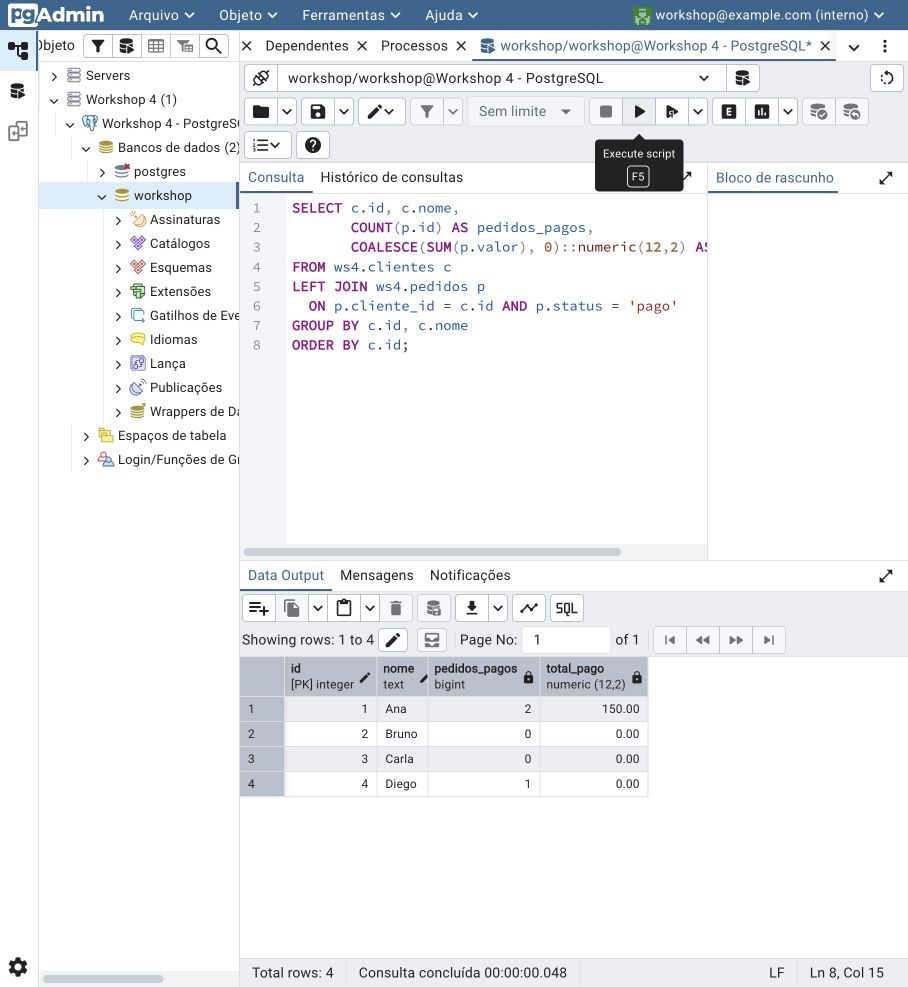

# pgAdmin e PostgreSQL em Docker

A interface gráfica da atividade é o **pgAdmin 4**, acessado pelo navegador. PostgreSQL e pgAdmin executam em contêineres separados, na mesma rede do projeto Docker Compose.

## Instalação e inicialização

Na raiz do repositório, com Docker Desktop em execução:

```bash
docker compose -p ws4-workshop --profile interface pull db pgadmin
docker compose -p ws4-workshop --profile interface up -d --wait
bash demo.sh base
bash demo.sh aplicar
```

As imagens são `postgres:17.12-alpine` e `dpage/pgadmin4:9.19`. O comando pull baixa as imagens. O comando up cria a rede, o volume de configuração e os serviços, aguardando os healthchecks. Um PostgreSQL já iniciado no mesmo projeto é reutilizado, sem criar outro banco em paralelo.

O atalho `bash demo.sh interface` equivale ao comando up acima. Para conferir:

```bash
docker compose -p ws4-workshop --profile interface ps
bash demo.sh conexao
bash scripts/validar-interface.sh
```

O último comando verifica HTTP, conexão autenticada a partir do contêiner do pgAdmin, dados e resultado da consulta de referência.

## Acesso no navegador

Abra **http://localhost:5050**.

| Acesso à interface pgAdmin | Valor didático |
|---|---|
| E-mail | workshop@example.com |
| Senha | pgadmin_local |

Na tela de login, pode selecionar **Portuguese (Brazilian)**. O cadastro do PostgreSQL já é importado automaticamente e a senha de conexão é provisionada por arquivo. Normalmente não é necessário registrar um servidor nem digitar a senha do banco.

As credenciais são exclusivas do ambiente didático local. O pgAdmin fica publicado somente em 127.0.0.1, não na rede externa.

## Conexão cadastrada

| Campo do servidor PostgreSQL | Valor |
|---|---|
| Grupo | Workshop 4 |
| Servidor | Workshop 4 - PostgreSQL |
| Host interno | db |
| Porta interna | 5432 |
| Banco | workshop |
| Usuário | workshop |
| Senha do banco | workshop_local |
| Schema | ws4 |

O navegador usa `localhost:5050` para chegar ao pgAdmin. O pgAdmin usa `db:5432` para chegar ao PostgreSQL. Não use localhost como host do PostgreSQL dentro do pgAdmin: ali, localhost seria o próprio contêiner da interface.

## Explorar tabelas e executar SQL

1. Expanda **Workshop 4 > Workshop 4 - PostgreSQL > Bancos de dados > workshop**.
2. Em **Esquemas > ws4**, consulte **Tabelas** e **Views**. A view `resumo_clientes` aparece depois de aplicar a consulta.
3. Selecione o banco **workshop** e abra **Ferramentas > Ferramenta de consulta** (Query Tool).
4. Cole uma consulta e clique em **Execute script** (F5). O resultado aparece em **Data Output**.

Primeira consulta:

```sql
SELECT current_database() AS banco, current_user AS usuario;
```

Depois:

```sql
SELECT * FROM ws4.clientes ORDER BY id;
SELECT * FROM ws4.pedidos ORDER BY id;
```

Para a sequência didática, use [consultas-pgadmin.sql](../exemplos/consultas-pgadmin.sql). Execute um bloco SELECT por vez ou selecione o trecho desejado. O arquivo contém somente comentários e SQL, sem metacomandos do psql.

Exemplo de consulta de referência executada no Query Tool, com os quatro clientes do contrato:



## Consulta, arquivo e Pull Request

O Query Tool executa o texto do editor no banco. Isso **não altera automaticamente os arquivos do repositório**.

Ao corrigir a implementação, mantenha a mudança também em `sql/02_consulta.sql`. Uma sequência consistente é editar o arquivo no editor de código, usar `bash demo.sh aplicar`, conferir os resultados no pgAdmin e executar `bash demo.sh testar`. Depois registre a evidência e faça o commit do arquivo corrigido.

Os arquivos `sql/01_base.sql`, `sql/03_testes.sql` e `exemplos/consultas-passo-a-passo.sql` incluem metacomandos do psql. Execute esses arquivos pelos comandos Bash do projeto, sem colá-los integralmente no Query Tool.

## Persistência e encerramento

As configurações e sessões do pgAdmin ficam no volume `pgadmin-data`. O banco do exercício mantém dados descartáveis. Se o contêiner do PostgreSQL for parado e os dados desaparecerem, execute `base` e `aplicar` novamente.

```bash
# Para parar somente a interface, mantendo o PostgreSQL:
docker compose -p ws4-workshop --profile interface stop pgadmin

# Para encerrar os serviços do workshop:
docker compose -p ws4-workshop --profile interface down
```

O comando down acima mantém o volume de configuração do pgAdmin. Não é necessário excluir volumes para repetir a atividade.

## Problemas comuns

- **Porta 5050 ocupada:** use `PGADMIN_PORT=5051 bash demo.sh interface` e abra localhost:5051.
- **Tabelas não aparecem:** confira o banco workshop, execute base e atualize a árvore de objetos.
- **Interface abre, mas o servidor não conecta:** confirme db:5432 e use `docker compose -p ws4-workshop --profile interface ps`.
- **Login do pgAdmin não funciona:** use o e-mail e a senha da interface, diferentes da credencial do PostgreSQL.
- **A view permanece corrigida ao trocar de branch:** execute aplicar. Trocar de branch altera arquivos, não a definição já aplicada no banco.

Referências: [implantação oficial em Docker](https://www.pgadmin.org/docs/pgadmin4/latest/container_deployment.html) e [pré-configuração de servidores](https://www.pgadmin.org/docs/pgadmin4/latest/import_export_servers.html).
