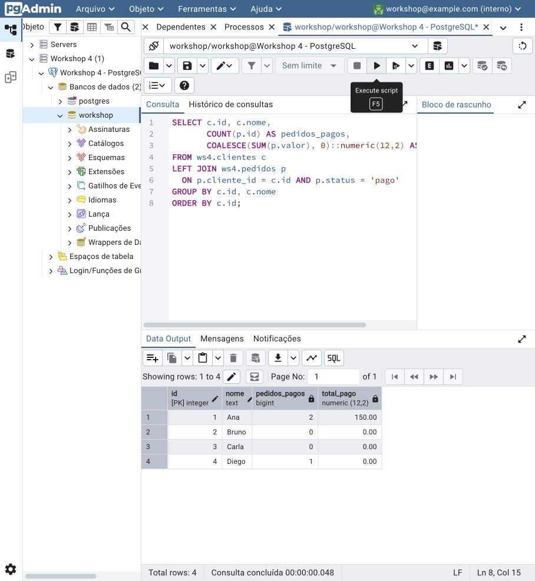

# Validação do pgAdmin · 18/11/2026

Ambiente: PostgreSQL 17.12 e pgAdmin 4 9.19 em Docker. A interface fica em localhost:5050 e usa o serviço db:5432 para alcançar o banco workshop.

## Conexão e interface

- Login na interface em português concluído.
- Servidor Workshop 4 - PostgreSQL importado automaticamente.
- Conexão ao banco sem solicitação adicional da senha PostgreSQL.
- Query Tool identificou banco workshop, usuário workshop, quatro clientes e cinco pedidos.
- Consulta inicial da view retornou Ana e Diego, conforme o problema conhecido.
- Consulta de referência retornou Ana 2/150, Bruno 0/0, Carla 0/0 e Diego 1/0.



## Validação automatizada da interface

Comando: `bash scripts/validar-interface.sh`.

```text
PASS: pgAdmin responde por HTTP
PASS: pgAdmin conecta a db:5432, banco workshop e usuário workshop
PASS: schema ws4, quatro clientes e cinco pedidos disponíveis
PASS: consulta de referência retorna os quatro resultados do contrato
INTERFACE VALIDADA: o teste não modifica a consulta inicial nem os dados
```

Código de saída: 0. A validação SQL separada, executada por scripts/validar-ambiente.sh, também passou: falha esperada da consulta inicial e aprovação da referência nos dois cenários.
